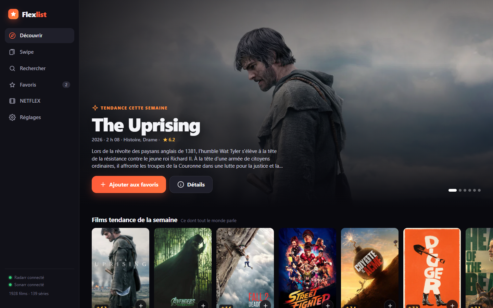
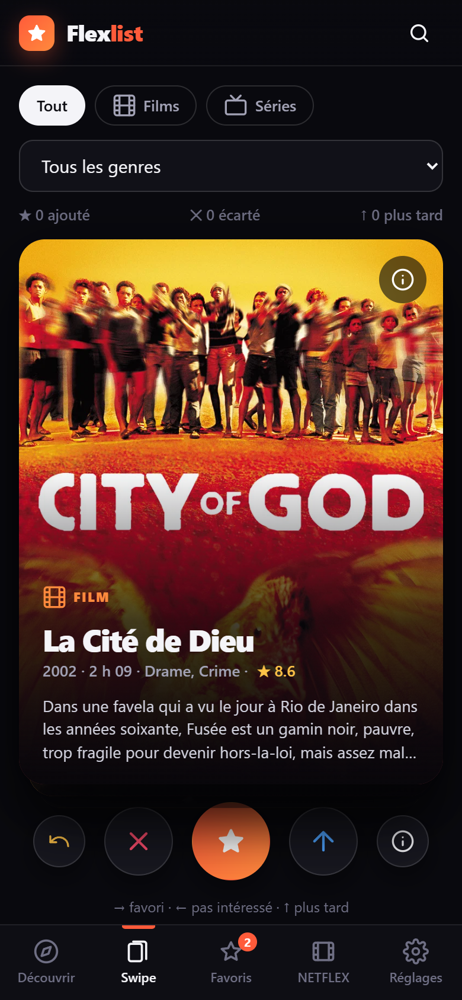
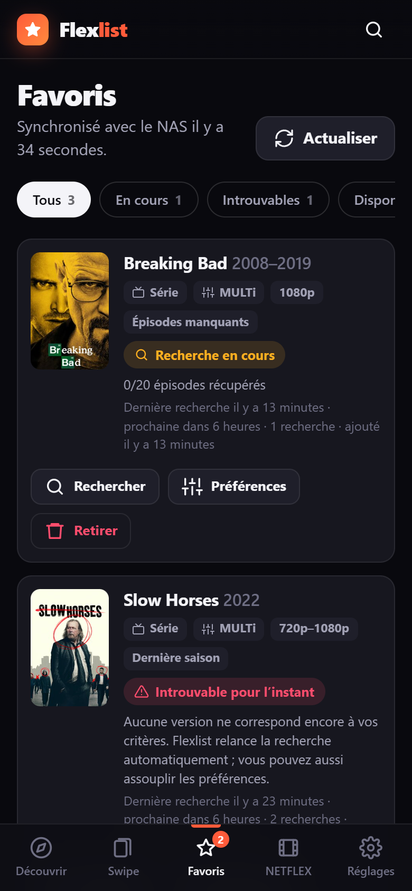
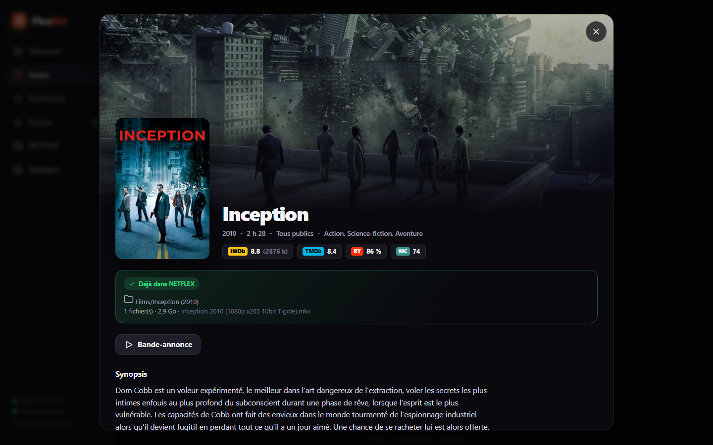
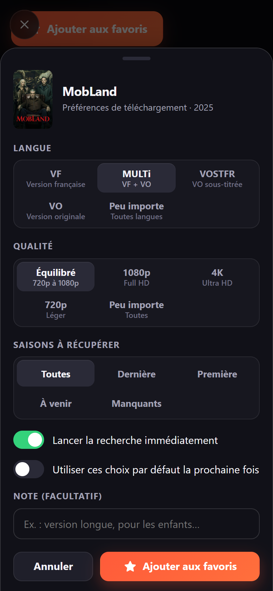
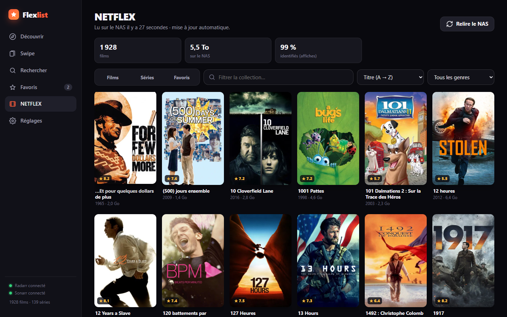

# Flexlist — rapport de réalisation

*7 octobre 2026*

## En bref

**Flexlist** est une application privée, installable sur téléphone, tablette et ordinateur, hébergée sur le NAS. Elle :

- propose des films et séries populaires **absents de `NETFLEX`** (mis à jour automatiquement) ;
- donne accès à **toute la vidéothèque NETFLEX** (1 928 films, 139 séries, avec affiches) et à la **liste des favoris** ;
- **demande les préférences de téléchargement à chaque favori** (VF, MULTi, VOSTFR, VO ; qualité ; saisons) ;
- **envoie la requête** au NAS (Radarr pour les films, Sonarr pour les séries) ;
- **relance régulièrement la recherche** des titres introuvables et **coche automatiquement** le favori dès qu'il apparaît dans `NETFLEX` ;
- offre en bonus un **mode Swipe** à la Letterboxd / Tinder.

Tout est développé, testé, et prêt à déployer. **Il reste deux actions de votre côté (environ 5 minutes)**, que je n'ai pas pu faire faute d'identifiants ; elles sont décrites plus bas.

### Aperçu

| Découvrir (ordinateur) | Swipe (téléphone) | Favoris (téléphone) |
|---|---|---|
|  |  |  |

| Fiche détaillée | Préférences à chaque favori | Vidéothèque NETFLEX |
|---|---|---|
|  |  |  |

Toutes les captures se trouvent dans `docs/captures/`.

---

## 1. État des lieux du NAS

| Élément | Constat |
|---|---|
| NAS | Asustor, `192.168.1.54` |
| Applications Docker en place | Radarr 5.27 (`:17878`), Sonarr 4.0 (`:18989`), Overseerr (`:25055`), Jackett (`:19117`), Transmission (`:29091`), qBittorrent, Lidarr, Home Assistant (`:8123`), Portainer CE (`:19900`), Plex (`:32400`) |
| Vidéothèque | `\\NAS-Yul\Home\NETFLEX` : 1 928 films, 139 séries (dossiers `@Doublons` et `@A Supprimer` ignorés) |
| Radarr | dossier racine `…/NETFLEX/Films`, indexeurs via Jackett, fonctionne |
| Sonarr | dossier racine `…/NETFLEX/Séries` qui fonctionne, **plus un second dossier racine `…/NETFLEX Drive/Séries` qui n'existe pas** (plus de 15 000 avertissements dans ses journaux). Je n'y ai pas touché ; Flexlist choisit automatiquement le dossier valide. |

Aucun fichier ni réglage existant n'a été supprimé ou modifié.

## 2. Ce qu'il vous reste à faire

L'outil de sécurité de cette session m'a interdit de lire les clés API (fichiers `config.xml`) et je n'ai pas les identifiants Portainer. Je n'ai donc pas contourné ces protections. Deux actions suffisent :

1. **Déployer** : Portainer (<http://192.168.1.54:19900>) › Stacks › Add stack › nom `flexlist` › coller `\\NAS-Yul\Docker\Flexlist\docker-compose.yml` › *Deploy*.
   L'application est ensuite sur **<http://192.168.1.54:18787>**.
2. **Connecter Radarr et Sonarr** : dans l'application, *Réglages › Connexion au NAS*, coller la clé API de chacun (Radarr/Sonarr › Settings › General), *Tester*, *Enregistrer*.

Ensuite, sur chaque appareil : ouvrir l'adresse puis « Ajouter à l'écran d'accueil ». Détails dans `README.md`.

> Les favoris ajoutés avant l'étape 2 ne sont pas perdus : ils attendent (« En attente d'envoi ») et partent dès la connexion.

## 3. Décisions prises (et pourquoi)

| Sujet | Décision | Raison |
|---|---|---|
| Type d'application | **Application web installable (PWA)**, servie par le NAS | Une seule application pour iPhone, Android, tablette et PC, sans store ni compte développeur, et mise à jour pour tous en une fois. C'est adapté à un usage privé. |
| Hébergement | Conteneur Docker sur le NAS, image officielle `node:24-alpine`, code déposé dans `\\NAS-Yul\Docker\Flexlist\app` | Rien à compiler, aucune dépendance à installer, mise à jour = remplacer des fichiers. Port **18787**, qui suit la convention du NAS (17878, 18989…). |
| Application « tierce » | **Radarr + Sonarr directement**, plutôt qu'Overseerr | Accès direct aux profils de qualité, aux commandes de recherche, à la file de téléchargement (progression en %) et aux épisodes présents. Overseerr reste disponible et intact. |
| Base de films | Base de métadonnées publique de **Radarr** (TMDb / IMDb) : tendances, populaires, Top 250 IMDb, recommandations | Aucune clé à créer, **titres et résumés en français**, affiches, notes IMDb / TMDb / Rotten Tomatoes. Mise à jour toutes les 12 h. |
| Base de séries | **TVmaze** : séries diffusées ces 7 derniers jours + index complet des séries populaires | Gratuit, sans clé, fournit l'identifiant TVDB dont Sonarr a besoin. Mise à jour quotidienne et hebdomadaire. |
| Préférences de téléchargement | Feuille de choix **à chaque favori** (pré-remplie avec vos habitudes), traduite en profils Radarr/Sonarr `Flexlist · <langue> · <qualité>` créés à la demande | Respecte exactement vos critères sans modifier vos profils existants. La langue est reconnue grâce aux noms des fichiers trouvés (`FRENCH`, `TRUEFRENCH`, `VFF`, `MULTi`, `VOSTFR`…). Remux et BR-DISK exclus (trop volumineux). |
| Titres introuvables | Statut « Introuvable pour l'instant » après 2 recherches sans résultat, **nouvelle recherche toutes les 6 h** (réglable de 1 h à 48 h), 5 au maximum par cycle | Les titres finissent par apparaître sans surcharger les indexeurs. |
| « Cocher » un titre arrivé | Relecture de NETFLEX toutes les 30 min ; le favori passe à **« Disponible dans NETFLEX ✓ »** | Correspond à votre demande, même si le fichier a été ajouté à la main. |
| Correspondance titres ↔ NETFLEX | Identifiants TMDb/TVmaze + titres français, originaux et alternatifs, insensible aux accents, articles et pluriels (« Les Simpson » = « The Simpsons »), avec contrôle de l'année à ±1 an | **1 914 films sur 1 928 (99 %) et 136 séries sur 139 (98 %) identifiés automatiquement**. Les titres restants sont très particuliers : montages personnels, volumes de dessins animés, vidéos promotionnelles ou interviews. Pour les séries, un second moteur (TVDB) reconnaît les titres français, par exemple « La Ligue des Justiciers » = *Justice League*. |
| Design | Thème sombre « salle de cinéma », accent orange, affiches en grand ; barre d'onglets en bas sur mobile, barre latérale sur ordinateur | Lisible le soir sur le canapé, et cohérent sur tous les écrans. |
| Nom | **Flexlist** (la liste d'envies de NETFLEX) | Court, et clairement relié à votre vidéothèque. |
| Sécurité | Vidéothèque montée **en lecture seule** ; clés API jamais renvoyées au navigateur ; **mot de passe d'accès facultatif** ; retirer un favori arrête seulement la surveillance (rien n'est supprimé) | Respect strict de la règle « ne rien supprimer ». |

### Fonctions ajoutées de ma propre initiative

- **Mode Swipe** (votre idée bonus) : glisser à droite = favori, à gauche = pas intéressé (ne sera plus proposé), vers le haut = plus tard, avec bouton d'annulation et raccourcis clavier.
- **« Pour vous »** : recommandations calculées à partir des films déjà présents sur le NAS.
- **Rangées par genre favori** et **« Séries pour vous »** selon les genres de votre collection.
- **Fiche détaillée** : notes IMDb / TMDb / Rotten Tomatoes / Metacritic, bande-annonce, casting, saisons présentes sur le NAS (en vert), titres similaires, historique de chaque favori.
- **« Compléter la série »** : sur une série déjà présente à laquelle il manque des épisodes, Sonarr ne télécharge que les manquants, dans le dossier existant.
- **Prénom par appareil** : on voit qui a ajouté quel favori.
- **Films pas encore sortis** : statut « Pas encore sorti », téléchargement automatique à la sortie.
- **Recherche universelle** : n'importe quel titre, en français ou en VO, avec ce qui est déjà sur le NAS en tête.

## 4. Tests réalisés

- Lecture réelle de `\\NAS-Yul\Home\NETFLEX` (en lecture seule) : 1 928 films, 139 séries, 5,5 To.
- Données réelles : 953 fiches de films populaires et 3 855 séries populaires, dont environ 200 diffusées cette semaine.
- **Envoi des requêtes testé de bout en bout sur un faux Radarr / Sonarr** reproduisant leur API, pour ne rien toucher sur le vrai NAS : création des formats et des profils, ajout de film et de série, choix du bon dossier racine (en écartant `NETFLEX Drive`), progression du téléchargement, passage en « Introuvable », relance de recherche, changement de préférences, retrait (surveillance arrêtée, rien de supprimé).
- Mot de passe : accès refusé sans session, connexion, déconnexion.
- Interface testée automatiquement dans Chrome au format ordinateur (1440 px) et téléphone (390 px) : **aucune erreur JavaScript, aucun débordement horizontal**. Captures dans `docs/captures/`.

## 5. Limites connues

- Les **résumés des séries sont en anglais** (TVmaze n'en fournit pas en français) ; ceux des films sont en français.
- La « popularité » des séries est celle de TVmaze (nombre d'abonnés), moins fine que celle de TMDb.
- L'**installation complète** (fenêtre dédiée, hors connexion) sur Android et PC exige une adresse **HTTPS**. En HTTP local, l'ajout à l'écran d'accueil fonctionne et l'iPhone se comporte comme une vraie application.
- Sonarr nomme les nouveaux dossiers à sa façon (`Nom (année)`), pas selon votre convention `Nom (début-fin)`.

## 6. Propositions pour la suite

1. **Notification quand un favori arrive** (« Dune est disponible ! ») via Home Assistant, déjà installé sur le NAS, ou via ntfy / Telegram.
2. **Bouton « Regarder sur Plex »** sur les titres disponibles (Plex est actif sur le NAS) ; il faudra un jeton Plex.
3. **Clé TMDb gratuite** (facultative) : résumés de séries en français, tendances séries plus justes, et « disponible sur Netflix / Prime / Disney+ » pour éviter des téléchargements inutiles.
4. **Accès sécurisé hors de la maison avec Tailscale** : HTTPS automatique, donc installation complète de l'application sur tous les appareils.
5. **Mode « Soirée » à plusieurs** : chacun swipe de son côté et l'application annonce un « match » quand tout le monde aime le même film.
6. **Calendrier** des prochains épisodes des séries suivies et des sorties de films en favoris.
7. **Sous-titres français automatiques** pour les VO avec Bazarr (installable via Portainer, compatible Radarr/Sonarr).
8. **Import d'une liste existante** (watchlist Letterboxd ou IMDb en CSV) directement dans les favoris.
9. **Statistiques de la vidéothèque** : genres, décennies, espace disque, films en basse qualité à remplacer.
10. **Petit ménage Sonarr** : retirer le dossier racine fantôme `NETFLEX Drive/Séries` (avec votre accord) et aligner le nommage sur votre convention `Nom (début-fin)`.

## 7. Fichiers livrés

```
\\NAS-Yul\Docker\Flexlist\          (nouveau dossier, rien d'existant modifié)
├── app\                  code de l'application (server\, public\)
├── data\                 base de l'application, déjà préremplie (catalogue + identification)
├── docs\captures\        captures d'écran
├── docker-compose.yml    stack Portainer
├── README.md             installation et utilisation
└── RAPPORT.md            ce rapport

C:\Users\PC\Videos\VS Code Claude\Table basse\flexlist\   (copie de travail + start-local.cmd + captures)
```
